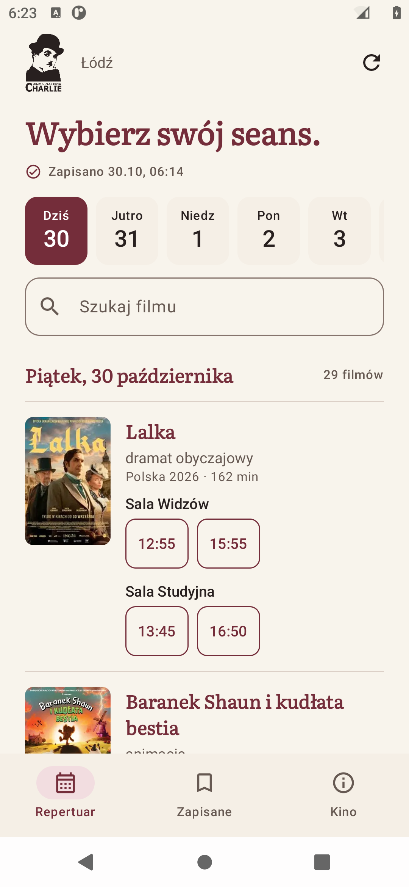
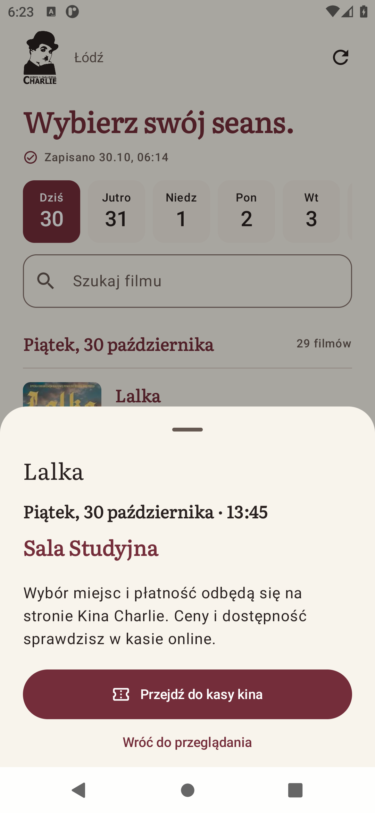
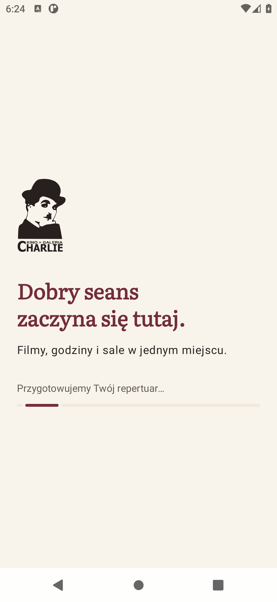
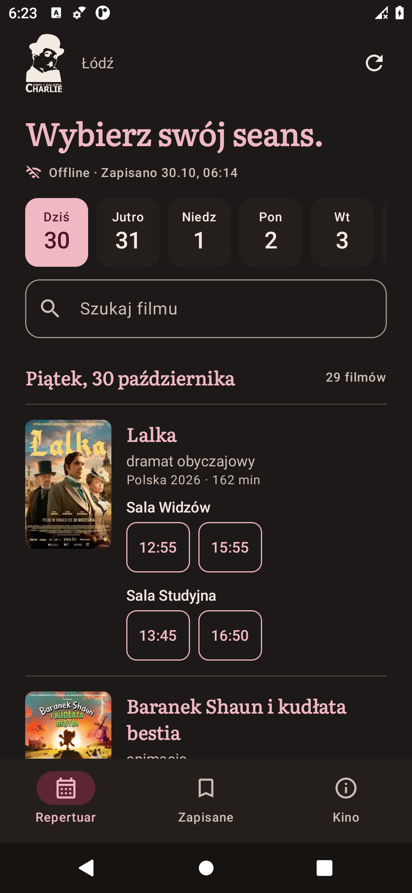

<p align="center"></p>

# Charlie · repertuar

**Kino Charlie w Łodzi, wygodnie w telefonie.** Nieoficjalna aplikacja Android: wybierz film, sprawdź salę i godzinę, a potem przejdź do kasy kina.

Kotlin · Jetpack Compose · Material 3 · Android 8.0+

<p align="center">
  
  
</p>

## Wypróbuj aplikację

**[Pobierz APK 0.1.2](https://github.com/piotrowskiadam/kino-charlie-android/releases/download/v0.1.2/Charlie-MVP-0.1.2.apk)** · [Wydanie](https://github.com/piotrowskiadam/kino-charlie-android/releases/tag/v0.1.2)

MVP do testowania na Androidzie 8 lub nowszym. Pobierz APK na telefon i zezwól wybranej przeglądarce lub menedżerowi plików na instalację tej aplikacji. Pierwsze przygotowanie wymaga internetu; następne uruchomienia korzystają z danych na urządzeniu. APK używa podpisu testowego. Sumę SHA-256 i wyniki kontroli zawiera [raport wydania](docs/qa/2026-10-30-0.1.2.md).

## Film, godzina i właściwa sala

- Repertuar na dziś i do 13 kolejnych dni, o ile kino opublikowało seanse.
- Godziny pogrupowane pod **wyraźną nazwą sali**. Ta sama godzina w różnych salach to osobne przyciski.
- Wyszukiwanie także bez polskich znaków, opisy filmów i zapisane ulubione.
- Plakaty kina oraz zapasowe obrazy z jego systemu biletowego, powiązane z konkretnym seansem.
- Jawnie opisane wyszukiwanie tytułu w Filmweb.

<p align="center"></p>

Zakup otwiera **dokładny link wybranego seansu** w karcie przeglądarki. Wybór miejsc, ceny, dostępność i płatność obsługuje strona kina. Aplikacja nie przetwarza płatności.

## Repertuar zostaje z Tobą

Pierwszy ekran powitalny przygotowuje dzisiejszy program. Gdy jest gotowy, możesz już przeglądać seanse; kolejne dni i zasoby pobierają się dalej w tle. Powitanie nie ma sztucznego czasu oczekiwania.

Później aplikacja pokazuje lokalny cache bez czekania na sieć. Odświeżanie nie blokuje przeglądania, a błąd połączenia zachowuje poprzednie dane. WorkManager odświeża repertuar co sześć godzin, gdy Android pozwoli; dostępne jest też ręczne odświeżanie. Bez konta, reklam i własnego serwera.

<p align="center">
  
  
</p>

Interfejs obsługuje jasny i ciemny motyw, powiększanie czcionki, systemowy przycisk Wstecz i nawigację boczną na szerokich ekranach.

## Uruchomienie projektu

Potrzebujesz **pełnego JDK 21**, Android SDK i platformy wymaganej przez `compileSdk` w [app/build.gradle.kts](app/build.gradle.kts). Otwórz projekt w Android Studio lub ustaw `JAVA_HOME` i lokalizację SDK przez `ANDROID_HOME` albo nieśledzony `local.properties`.

```bash
git clone https://github.com/piotrowskiadam/kino-charlie-android.git
cd kino-charlie-android
./gradlew :app:assembleDebug
```

Bez klucza do bazy filmów i konfiguracji backendu. [Przewodnik developmentu](docs/DEVELOPMENT.md) opisuje środowisko, budowanie wydania i testowanie na urządzeniu.

## Testy

```bash
./gradlew :app:testDebugUnitTest :app:lintDebug
# Przy uruchomionym emulatorze lub podłączonym urządzeniu:
./gradlew :app:connectedDebugAndroidTest
```

Testy obejmują import prawdziwych fixture HTML, zgodność sal i biletów, dopasowanie plakatów, cache po restarcie oraz interakcje Compose. Opcjonalny test żywej strony jest oddzielony od testów deterministycznych. Rzeczywisty zakres kontroli i screenshotów opisuje [raport 0.1.2](docs/qa/2026-10-30-0.1.2.md).

## Architektura i dalszy rozwój

UI obserwuje lokalny katalog przez `StateFlow`. Repozytorium zapisuje każdy poprawny dzień atomowo i udostępnia go od razu. Pobieranie repertuaru, opisów i obrazów jest oddzielone od zakupów w przeglądarce.

- [Dokumentacja](docs/README.md) — mapa projektu i zasady aktualizacji.
- [Architektura](docs/ARCHITECTURE.md) — moduły, synchronizacja i format zapisu.
- [Design](DESIGN.md) — zatwierdzony kierunek, tokeny, komponenty i stany.
- [Produkt](PRODUCT.md) i [specyfikacja MVP](docs/specs/mvp.md) — zakres i kryteria akceptacji.
- [Źródła i zasoby](NOTICE.md) — pochodzenie logo, plakatów, ikon i fontu.

HTML kina może się zmieniać. Cache obejmuje faktycznie opublikowane seanse. Obrazy MSI mają ograniczoną rozdzielczość; aplikacja nie powiększa małych miniatur głównej strony i nie wymyśla grafiki. Android decyduje o wykonaniu pracy w tle; wymuszone zatrzymanie aplikacji wstrzymuje ją do kolejnego otwarcia.

Dane: [Kino Charlie](https://www.charlie.pl/) i [system biletowy](https://bilety.charlie.pl/MSI/mvc/pl). Projekt nie jest oficjalną aplikacją kina.
