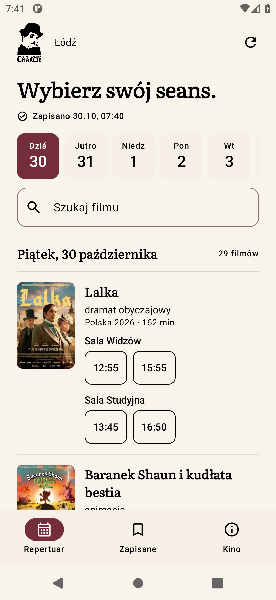
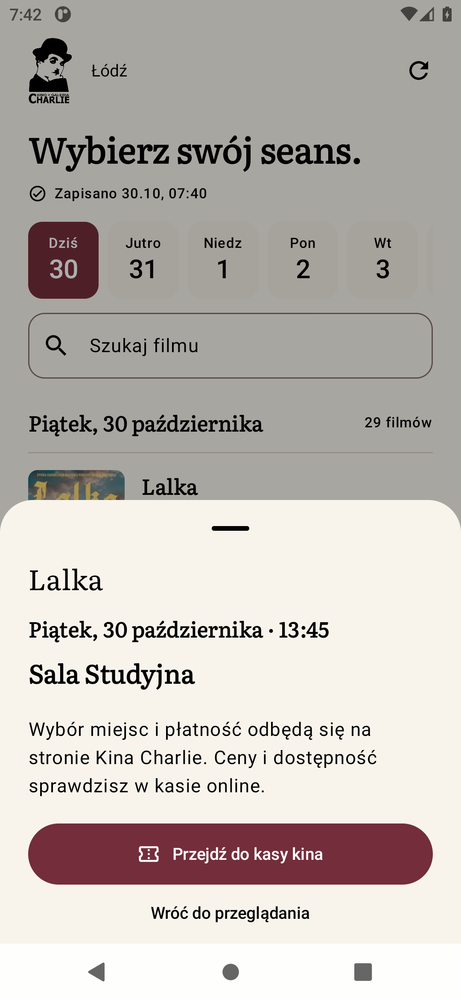
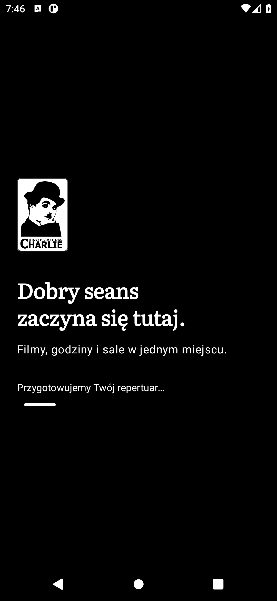
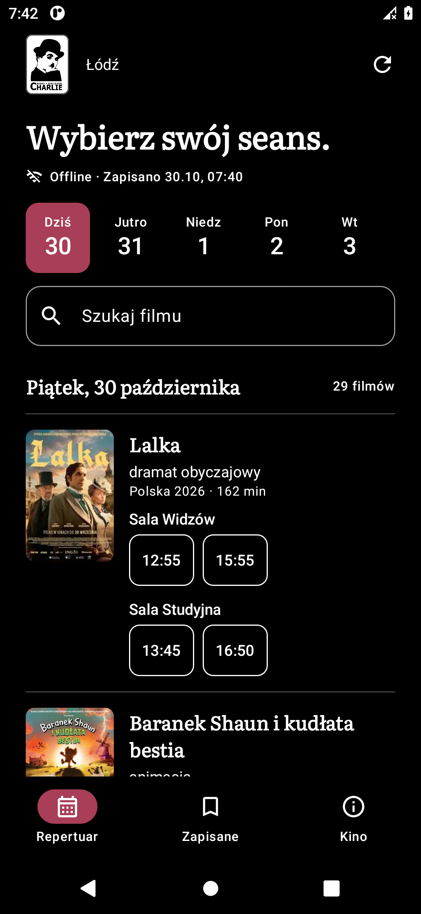
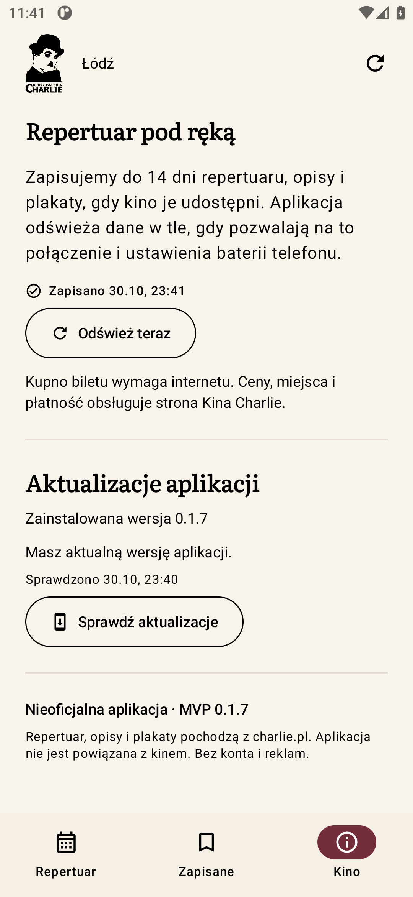
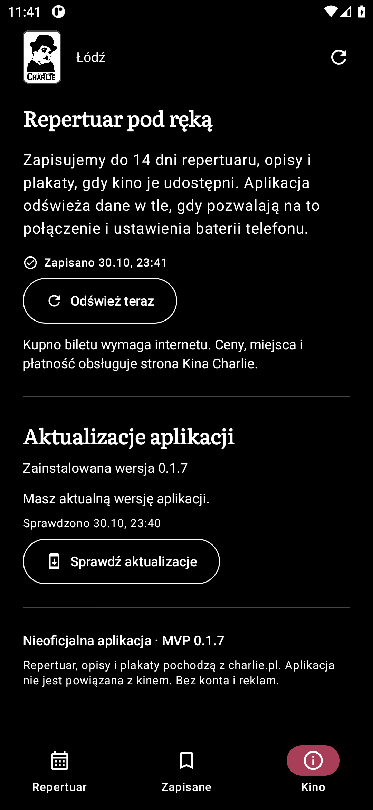

<p align="center"></p>

# Charlie · repertuar

**Kino Charlie w Łodzi, wygodnie w telefonie.** Nieoficjalna aplikacja Android: wybierz film, sprawdź salę i godzinę, a potem przejdź do kasy kina.

Kotlin · Jetpack Compose · Material 3 · Android 8.0+

[Licencja kodu: MIT](LICENSE) · [Prawa do materiałów i źródła](NOTICE.md)

**Niezależny projekt hobbystyczny, udostępniany bezpłatnie i bez celu zarobkowego.** Autor nie jest powiązany z Kinem Charlie; aplikacja powstała jako alternatywny, wygodny sposób przeglądania publicznego repertuaru. [Charakter projektu i zastrzeżenia](#charakter-projektu-i-zastrzeżenia).

<p align="center">
  
  
</p>

## Wypróbuj aplikację

**[Pobierz APK 0.1.7](https://github.com/piotrowskiadam/kino-charlie-android/releases/download/v0.1.7/Charlie-MVP-0.1.7.apk)** · [Wydanie](https://github.com/piotrowskiadam/kino-charlie-android/releases/tag/v0.1.7)

MVP do testowania na Androidzie 8 lub nowszym. Pobierz APK na telefon i zezwól wybranej przeglądarce lub menedżerowi plików na instalację tej aplikacji. Pierwsze przygotowanie wymaga internetu; następne uruchomienia korzystają z danych na urządzeniu. APK używa podpisu testowego. Sumę SHA-256 i wyniki kontroli zawiera [raport wydania](docs/qa/2026-10-30-0.1.7.md).

## Film, godzina i właściwa sala

- Repertuar na dziś i do 13 kolejnych dni, o ile kino opublikowało seanse.
- Godziny pogrupowane pod **wyraźną nazwą sali**. Ta sama godzina w różnych salach to osobne przyciski.
- Wyszukiwanie także bez polskich znaków, opisy filmów i zapisane ulubione.
- Plakaty kina oraz zapasowe obrazy z jego systemu biletowego, powiązane z konkretnym seansem.
- Jawnie opisane wyszukiwanie tytułu w Filmweb.

<p align="center"></p>

Zakup otwiera **dokładny link wybranego seansu** w karcie przeglądarki. Wybór miejsc, ceny, dostępność i płatność obsługuje strona kina. Aplikacja nie przetwarza płatności.

## Repertuar zostaje z Tobą

Pierwszy ekran powitalny przygotowuje dzisiejszy program. Gdy jest gotowy, możesz już przeglądać seanse; kolejne dni i zasoby pobierają się dalej w tle. Powitanie nie ma sztucznego czasu oczekiwania.

Później aplikacja pokazuje lokalny cache bez czekania na sieć. Odświeżanie nie blokuje przeglądania, a błąd połączenia zachowuje poprzednie dane. WorkManager odświeża repertuar co sześć godzin, gdy Android pozwoli; dostępne jest też ręczne odświeżanie. Bez konta, reklam i własnego serwera.

<p align="center">
  
  
</p>

Interfejs obsługuje jasny motyw z czarnym tekstem i ciemny motyw OLED z białym tekstem oraz czystą czernią tła, powiększanie czcionki, systemowy przycisk Wstecz i nawigację boczną na szerokich ekranach.

## Aktualizacje aplikacji

W zakładce **Kino → Aktualizacje aplikacji** sprawdzisz zainstalowaną wersję i dostępne wydanie. Aplikacja sprawdza GitHuba w tle najwyżej raz na dobę podczas używania; możesz też wybrać **Sprawdź aktualizacje**. Nowa wersja dodaje dyskretną kropkę na zakładce Kino.

**Pobierz aktualizację** pobiera APK wewnątrz aplikacji, pokazując postęp i możliwość anulowania. Gotowy plik pozostaje na telefonie po restarcie; **Zainstaluj aktualizację** działa także offline i otwiera instalator Androida. Przy pierwszej takiej instalacji zezwól Charlie na instalowanie aplikacji z tego źródła, a następnie potwierdź aktualizację. Przeglądarka i menedżer plików nie uczestniczą w pobieraniu. Przerwany transfer można ponowić od początku. Nowy przepływ jest dostępny od 0.1.6; starszy klient pobierze tę pierwszą aktualizację dotychczasowym sposobem. Repertuar działa niezależnie od aktualizacji; brak sieci zachowuje poprzednią informację. Wykrywane są zwykłe wydania z właściwym APK, z pominięciem draft i prerelease.

<p align="center">
  
  
</p>

## Uruchomienie projektu

Potrzebujesz **pełnego JDK 21**, Android SDK i platformy wymaganej przez `compileSdk` w [app/build.gradle.kts](app/build.gradle.kts). Otwórz projekt w Android Studio lub ustaw `JAVA_HOME` i lokalizację SDK przez `ANDROID_HOME` albo nieśledzony `local.properties`.

```bash
git clone https://github.com/piotrowskiadam/kino-charlie-android.git
cd kino-charlie-android
./gradlew :app:assembleDebug
```

Bez klucza do bazy filmów i konfiguracji backendu. [Przewodnik developmentu](docs/DEVELOPMENT.md) opisuje środowisko, budowanie wydania i testowanie na urządzeniu.

## Testy

```bash
./gradlew :app:testDebugUnitTest :app:lintDebug
# Przy uruchomionym emulatorze lub podłączonym urządzeniu:
./gradlew :app:connectedDebugAndroidTest
```

Testy obejmują import prawdziwych fixture HTML, zgodność sal i biletów, dopasowanie plakatów, cache po restarcie oraz interakcje Compose. Opcjonalny test żywej strony jest oddzielony od testów deterministycznych. Rzeczywisty zakres kontroli i screenshotów opisuje [raport 0.1.7](docs/qa/2026-10-30-0.1.7.md).

## Architektura i dalszy rozwój

UI obserwuje lokalny katalog przez `StateFlow`. Repozytorium zapisuje każdy poprawny dzień atomowo i udostępnia go od razu. Pobieranie repertuaru, opisów i obrazów jest oddzielone od zakupów w przeglądarce.

- [Dokumentacja](docs/README.md) — mapa projektu i zasady aktualizacji.
- [Architektura](docs/ARCHITECTURE.md) — moduły, synchronizacja i format zapisu.
- [Design](DESIGN.md) — zatwierdzony kierunek, tokeny, komponenty i stany.
- [Produkt](PRODUCT.md) i [specyfikacja MVP](docs/specs/mvp.md) — zakres i kryteria akceptacji.
- [Źródła i zasoby](NOTICE.md) — pochodzenie logo, plakatów, ikon i fontu.

HTML kina może się zmieniać. Cache obejmuje faktycznie opublikowane seanse. Obrazy MSI mają ograniczoną rozdzielczość; aplikacja nie powiększa małych miniatur głównej strony i nie wymyśla grafiki. Android decyduje o wykonaniu pracy w tle; wymuszone zatrzymanie aplikacji wstrzymuje ją do kolejnego otwarcia.

Dane: [Kino Charlie](https://www.charlie.pl/) i [system biletowy](https://bilety.charlie.pl/MSI/mvc/pl). Projekt nie jest oficjalną aplikacją kina.

## Licencja kodu

Własny kod i dokumentacja projektu są udostępniane na [licencji MIT](LICENSE). Możesz je wykorzystywać, modyfikować i rozpowszechniać, również komercyjnie, zachowując informację o prawach autorskich i tekst licencji. Licencja zawiera wyłączenie gwarancji i odpowiedzialności w zakresie dopuszczalnym prawem.

Niekomercyjny charakter tej aplikacji opisuje sposób prowadzenia projektu przez autora; nie ogranicza uprawnień innych osób wynikających z MIT. Licencja projektu nie obejmuje cudzych materiałów: oficjalnego logo i nazwy kina, repertuaru, opisów ani plakatów, także widocznych na screenshotach. Font i zależności zachowują własne licencje — szczegóły w [NOTICE.md](NOTICE.md).

## Charakter projektu i zastrzeżenia

Charlie · repertuar jest niezależnym, niekomercyjnym projektem hobbystycznym. Aplikacja jest udostępniana bezpłatnie, bez reklam i opłat za korzystanie; jej celem jest wyłącznie zapewnienie alternatywnego, wygodnego sposobu przeglądania publicznie dostępnego repertuaru Kina Charlie.

Autor nie jest związany organizacyjnie ani kapitałowo z Kinem-Galerią Charlie, nie reprezentuje kina i nie działa w jego imieniu. Aplikacja nie jest oficjalnym produktem kina. Projekt nie deklaruje autoryzacji, patronatu ani wsparcia ze strony kina. Użycie nazwy oraz logo służy identyfikacji źródła repertuaru i nie oznacza patronatu, partnerstwa ani rekomendacji.

Prawa do nazwy i oficjalnego logo kina, opisów, plakatów oraz pozostałych materiałów źródłowych należą do odpowiednich uprawnionych. Dotyczy to również takich materiałów widocznych na screenshotach. Projekt nie przenosi tych praw ani nie udziela licencji na zasoby podmiotów trzecich. Pochodzenie zasobów i ich odrębne warunki opisano w [NOTICE.md](NOTICE.md). Publiczna dostępność materiałów i niekomercyjny charakter projektu same w sobie nie oznaczają zgody uprawnionych na ich wykorzystanie.

Repertuar jest odczytywany z zewnętrznych stron i przechowywany w cache, dlatego może być niepełny, nieaktualny lub zawierać błędy. Przed zakupem lub wizytą sprawdź godzinę, salę, cenę i dostępność na [oficjalnej stronie kina](https://www.charlie.pl/) albo w jego [systemie sprzedaży](https://bilety.charlie.pl/MSI/mvc/pl). Wybór miejsc, płatności i zawarcie umowy zakupu odbywają się poza aplikacją, w serwisie kina.

Oprogramowanie jest udostępniane w stanie, w jakim się znajduje, bez zapewnienia kompletności, aktualności i nieprzerwanego działania. Wyłączenia gwarancji i odpowiedzialności mogą mieć zastosowanie wyłącznie w zakresie dopuszczalnym przez obowiązujące prawo; niniejszy opis nie wyłącza praw, których nie można wyłączyć ustawowo.
