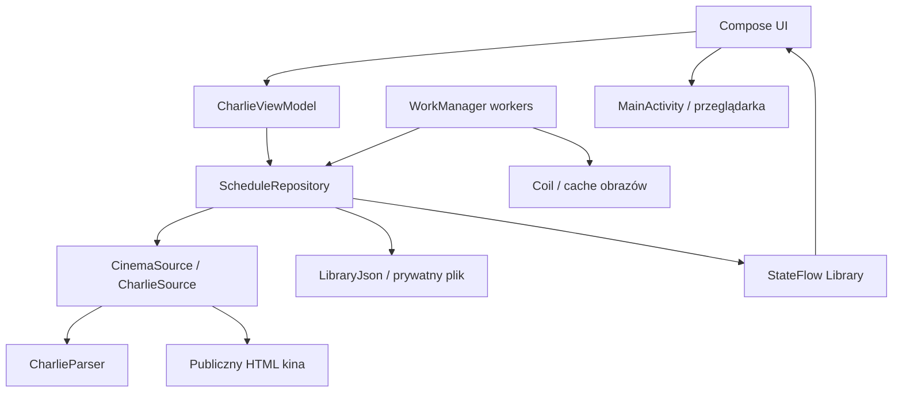

# Architektura aplikacji

Opis bieżącej implementacji MVP. Kontekst wyboru lokalnych snapshotów i zakupu w przeglądarce: [ADR 001](adr/001-offline-schedule.md). Znaczenie pojęć: [GLOSSARY](../GLOSSARY.md).

## Granice systemu

Aplikacja działa bez własnego serwera i konta użytkownika. Czyta publiczny repertuar kina, zapisuje lokalny katalog i przekazuje wybrany seans do strony sprzedażowej. Przeglądanie korzysta ze stanu lokalnego; płatność, miejsca i sesja zakupowa należą do przeglądarki.

Strzałki pokazują zależności i przepływ stanu; nie oznaczają, że Compose wykonuje żądania HTML. Obrazy mogą być ładowane przez Coil również podczas wyświetlania w UI.

## Mapa kodu

Wszystkie ścieżki Kotlin poniżej znajdują się w `app/src/main/java/pl/charlie/repertuar/`.

| Plik | Odpowiedzialność |
| --- | --- |
| [MainActivity.kt](../app/src/main/java/pl/charlie/repertuar/MainActivity.kt) | Zbiera stan z uwzględnieniem cyklu życia, wywołuje sprawdzenie po wznowieniu, otwiera zewnętrzne adresy |
| [CharlieViewModel.kt](../app/src/main/java/pl/charlie/repertuar/CharlieViewModel.kt) | Stan odświeżania, komunikaty błędów, łączność i bieżąca data kina; obsługa intencji UI |
| [CharlieApplication.kt](../app/src/main/java/pl/charlie/repertuar/CharlieApplication.kt) | Składanie zależności, wspólne repozytorium i ImageLoader, rejestracja pracy w tle; klasy SyncWorker i AssetsWorker |
| [ui/CharlieApp.kt](../app/src/main/java/pl/charlie/repertuar/ui/CharlieApp.kt) | Ekrany, lokalny stan nawigacji, wybór daty, wyszukiwanie, szczegóły i wybór seansu |
| [StartupPhase.kt](../app/src/main/java/pl/charlie/repertuar/StartupPhase.kt) | Stan decyzji o pierwszym ekranie, oddzielony od trwałego katalogu |
| [ui/FirstRunWelcome.kt](../app/src/main/java/pl/charlie/repertuar/ui/FirstRunWelcome.kt) | Przygotowanie pierwszego repertuaru i odzyskanie po błędzie |
| [ui/CinemaLogo.kt](../app/src/main/java/pl/charlie/repertuar/ui/CinemaLogo.kt) | Lokalny znak kina, obszar źródłowy i dopasowanie do motywu |
| [ui/CharlieTheme.kt](../app/src/main/java/pl/charlie/repertuar/ui/CharlieTheme.kt) | Wykonywalne definicje kolorów i typografii |
| [data/Models.kt](../app/src/main/java/pl/charlie/repertuar/data/Models.kt) | Film, Screening, ScheduleDay i Library |
| [data/ScheduleRepository.kt](../app/src/main/java/pl/charlie/repertuar/data/ScheduleRepository.kt) | Wspólny odczyt/zapis katalogu, odświeżanie, uzupełnianie opisów i zakładki |
| [data/CharlieSource.kt](../app/src/main/java/pl/charlie/repertuar/data/CharlieSource.kt) | Interfejs CinemaSource, HTTP i kodowanie znaków; SourceLinks waliduje adresy |
| [data/CharlieParser.kt](../app/src/main/java/pl/charlie/repertuar/data/CharlieParser.kt) | HTML i dane strukturalne źródła → modele; walidacja dnia i powiązania seansu |
| [data/LibraryJson.kt](../app/src/main/java/pl/charlie/repertuar/data/LibraryJson.kt) | Jawny, wersjonowany format zapisu bez refleksyjnej serializacji modeli |

## Odczyt i odświeżanie

Po wznowieniu `MainActivity` wywołuje `onResume()` ViewModelu. Repozytorium ładuje plik w `Dispatchers.IO` i publikuje `Library` przez `StateFlow`. Odczyt pliku jest wykonywany raz na instancję repozytorium. UI obserwuje dane, zamiast czekać na zakończenie pobierania. `StartupPhase` rozróżnia odczyt cache, pierwsze przygotowanie, gotowy katalog i błąd. Po lokalnym odczycie dowolny zachowany katalog od razu otwiera program. Przy pustym cache ekran powitalny ustępuje po trwałym zapisie dzisiejszego dnia, również bez seansów; dalszy import nie blokuje nawigacji. Jeśli sieć wraca po błędzie pierwszego przygotowania, zmiana łączności ponawia próbę. Przycisk ponowienia pozostaje dostępną drogą odzyskania po błędzie. Nie zapisujemy redundantnej flagi onboardingu: istniejący katalog jest dowodem gotowości.

ViewModel aktualizuje datę według `Europe/Warsaw`. Odświeżenie uruchamia, jeśli najnowszy zapis katalogu ma ponad sześć godzin albo brakuje dzisiejszego dnia. Ręczne odświeżenie używa tej samej ścieżki. Świeży cache ze starszej wersji również uruchamia uzupełnianie brakujących plakatów (raz na ViewModel), bez oczekiwania na sześciogodzinny termin odświeżenia katalogu. Dni bez seansów z linkiem biletowym nie wywołują zapytań o niemożliwe do dopasowania obrazy. Zmieniona data przekazana do Compose resetuje wybór dnia przez klucz `rememberSaveable`.

`refresh(start, count)` pobiera kolejne daty sekwencyjnie. Każdy poprawny dzień trafia na dysk i do stanu od razu; użytkownik nie czeka na cały zakres. Opisy już pobrane są zachowywane przy scalaniu nowych danych. Błąd dnia pozostawia poprzedni zapis. Jeśli błąd wystąpi przed pierwszym sukcesem, metoda kończy próbę całego zakresu; wtedy `failedDays` opisuje nieuzupełniony zakres, a nie liczbę wykonanych żądań HTTP.

`refreshLock` serializuje odświeżenia. `stateLock` chroni scalanie i zapis, także przy równoległym zapisywaniu filmu lub uzupełnianiu opisu. Są to blokady wewnątrz procesu; aplikacja nie konfiguruje osobnego procesu workerów.

## Zapis lokalny

| Zasób | Lokalizacja i reguła |
| --- | --- |
| Katalog, opisy, zapisane filmy | `filesDir/schedule/library.json`, format `version = 1` |
| Zapis roboczy | `library.tmp` → synchronizacja strumienia → atomowe zastąpienie pliku → publikacja nowego stanu |
| Obrazy | Prywatny `filesDir/posters`, cache Coil z limitem 80 MiB |

JSON przechowuje filmy wspólnie, dni odwołują się do ich identyfikatorów, a zakładki są zbiorem `savedIds`. Dekoder ponownie waliduje adresy zakupowe. Podczas udanego odświeżenia repozytorium usuwa dni spoza okna od wczoraj do `start + 13 dni`; zachowuje filmy obecne w dniach oraz zapisane przez użytkownika.

Brak pliku, nieczytelny JSON lub nieobsługiwana wersja daje obecnie pustą bibliotekę. Nie ma migracji ani pliku zapasowego. Przy zmianie formatu trzeba zaprojektować zgodny odczyt/migrację i zachowanie zakładek, zanim zmieni się wersję schematu. Samego numeru wersji aplikacji nie traktujemy jako migracji cache.

## Praca w tle i obrazy

`charlie-schedule` to unikalna praca okresowa WorkManager: sześć godzin, początkowe opóźnienie 20 minut, dostępna sieć i bateria powyżej niskiego poziomu. Polityka `KEEP` zachowuje istniejący harmonogram. Android ustala rzeczywisty moment wykonania.

`SyncWorker` ładuje katalog, odświeża do 14 dat i uzupełnia zasoby. Brak poprawnie odświeżonych dni lub częściowe niepowodzenie powoduje `retry`. Po uzyskaniu pierwszego dzisiejszego dnia i po zakończeniu odświeżenia UI kolejkuje `charlie-assets`: dodatkowe adresy plakatów, opisy oraz obrazy, z wymaganą siecią. `APPEND_OR_REPLACE` wykonuje te prace kolejno, aby końcowa praca uwzględniła również dni, które dopłynęły podczas pierwszej.

Kolejność obrazu: pełny plakat → obraz systemu biletowego → widoczny placeholder. Nie powiększamy maleńkich miniatur głównej strony. UI i prefetch korzystają ze wspólnego ImageLoadera. Część adresów pełnych plakatów zwraca 404. Sprawdzony obraz MSI ma 260×380 px; to poprawa względem małych miniatur, bez deklaracji jakości HD. `detailsFetched` oznacza pobrany niepusty opis; obecnie poprawnie pobrane opisy nie mają osobnego terminu wygaśnięcia.

## Kontrakty źródła i zakupu

Parser łączy wiersz HTML zawierający film, salę, godzinę i bilet z odpowiednim `ScreeningEvent`. Dane strukturalne dostarczają m.in. pełny plakat, reżysera i czas trwania. Nagłówek musi odpowiadać żądanej dacie; rozbieżność liczby odczytanych seansów względem danych strukturalnych odrzuca import. Dekodowanie HTTP/meta charset obsługuje starsze ISO-8859-2. HTML pozostaje w warstwie danych i nie jest renderowany jako interfejs aplikacji.

`SourceLinks` dopuszcza HTTPS, właściwy host, brak danych logowania w URL i domyślny port HTTPS. Główny katalog i plakaty pochodzą z `charlie.pl` lub `www.charlie.pl`; `bilety.charlie.pl` dostarcza zakup oraz ograniczoną listę i obrazy MSI opisane poniżej. Dokładny adres seansu pochodzi z importu. ViewModel nie przetwarza płatności. Filmweb jest osobno konstruowanym, jawnie opisanym wyszukiwaniem po tytule.

### Zatwierdzone źródło dodatkowe

Użytkownik dopuścił publiczną listę `bilety.charlie.pl/MSI/mvc/pl` jako źródło uzupełniające. Jej [rozpoznanie i warunki integracji](sources/bilety-charlie.md) opisują dostępne pola, identyfikatory seansów oraz zaobserwowane konflikty. Od 0.1.2 adapter pobiera z niej wyłącznie adresy plakatów. Dopasowanie wymaga tego samego event_id, daty, godziny i tytułu. Nie zmienia sal, czasu trwania ani adresów zakupu. Opcjonalny `Film.ticketPosterUrl` jest zapisywany w JSON v1; brak pola w starszym cache oznacza pusty adres. Odświeżenie oraz uzupełnianie opisów zachowują ten adres, także przy równoległych operacjach. `SourceLinks.poster` dopuszcza na subdomenie tylko `/MSI/ImageData.ashx` z numerycznym id i opcjonalnym trybem thumb. Odczyt katalogu dopuszcza tylko konkretną ścieżkę listy i parametr daty; HTTP nie podąża za przekierowaniami. Przed wdrożeniem alternatywnego odczytu trzeba zachować potwierdzone nazwy sal, tożsamość seansu, reguły adresów i ochronę cache przed niepełnymi danymi.

## Granice zmian i testowania

Sala jest istotną informacją wyboru seansu, zapisaną w istniejącym `Screening.room`. UI grupuje godziny według sal zarówno w repertuarze, jak i w zapisanych filmach; podgląd zapisanych obejmuje do trzech seansów na salę. Klucz seansu zawiera datę, godzinę, film i salę, więc identyczne godziny w różnych salach zachowują osobne akcje i adresy zakupowe. Szczegóły i arkusz zakupu powtarzają nazwę sali. Ta zmiana prezentacji nie zmienia formatu zapisu. Wymagania: [Widoczność sal](specs/rooms.md).

Zmianę struktury strony zaczynamy od nowego rzeczywistego fixture i regresji parsera. Zmiana trwałego stanu wymaga testu ponownego otwarcia oraz nieudanej synchronizacji przez publiczne API repozytorium. Zmiany stanów i nawigacji pokrywamy testami Compose. Polecenia i zakres kontroli przed wydaniem: [Development](DEVELOPMENT.md). Historia wyników MVP: [QA](QA.md).

## Wydania i aktualizacje aplikacji

`updates/UpdateRepository.kt` jest niezależne od repertuaru. `GitHubReleaseSource` czyta publiczne `GET /repos/piotrowskiadam/kino-charlie-android/releases/latest` bez tokena, z API version 2026-03-10. [Dokumentacja GitHuba](https://docs.github.com/en/rest/releases/releases#get-the-latest-release) opisuje kanał wydań; adapter dodatkowo odrzuca draft i prerelease oraz wymaga dokładnego tagu vX.Y.Z, strony własnego repozytorium i przesłanego APK o nazwie Charlie-MVP-X.Y.Z.apk. Adresy otwierane przez UI są wyliczane z niezmiennego repozytorium i liczbowej wersji, zamiast przejmowania dowolnych linków odpowiedzi.

`AppVersion` porównuje major, minor i patch liczbowo. Repozytorium publikuje `UpdateState` przez StateFlow, zachowuje ostatnie poprawne metadane w osobnym `filesDir/updates/latest.json` (schema 1, opcjonalny numer wydania, czas ostatniego sukcesu i osobny czas ostatniej próby) i ponownie ocenia dostępność względem zainstalowanej wersji. Plik roboczy jest zastępowany atomowo; utrata opcjonalnej informacji o aktualizacji nie zmienia katalogu ani zakładek. Błąd sieci lub nieprawidłowe wydanie zachowują poprzedni poprawny wynik. Cache błędny lub nieznany schemat oznacza potrzebę nowego sprawdzenia.

Przed żądaniem repozytorium zapisuje czas próby, także gdy nie ma jeszcze poprawnego wydania; błąd HTTP, anulowanie i ponowne utworzenie procesu nie omijają dobowego limitu. Gdy nie można zapisać limitu na dysku, automatyczne żądanie jest pomijane, a ręczne nadal może działać. Sprawdzenie po wznowieniu aplikacji lub powrocie sieci jest asynchroniczne i ograniczone do 24 godzin; ręczne sprawdzenie omija odstęp, lecz nie tworzy równoległych żądań. Mutex aktualizacji jest oddzielny od blokad katalogu. HTTP ma limity 8 sekund połączenia i odczytu, bez przekierowań. Nie ma periodycznego workera, powiadomień ani automatycznego pobierania APK przy zamkniętej aplikacji.

`ui/AppUpdateSection.kt` grupuje stan i akcje sekcji Kino; nowa wersja oznacza także dyskretną dostępną kropkę w nawigacji. Od 0.1.6 `ApkDownloadRepository` obsługuje osobny transfer wewnątrz aplikacji: postęp rzeczywistych bajtów, anulowanie, sprawdzanie pliku i stan gotowości. `CharlieApplication` utrzymuje jego krótkie zadanie w CoroutineScope procesu, niezależnie od nawigacji i odtworzenia Activity. Zakończenie procesu podczas transferu wymaga ponowienia od początku; plik gotowy jest trwały. Nie ma pobierania bez żądania użytkownika, powiadomień ani usługi pierwszoplanowej. Zmiana decyzji o przekazaniu pobierania przeglądarce: [ADR 002](adr/002-native-apk-updates.md).

`GitHubReleaseSource` i cache metadanych zachowują także rozmiar oraz opcjonalny SHA-256 z pola digest. Starszy JSON schema 1 bez tych pól nadal jest odczytywany; przed pobieraniem aplikacja odświeża brakujące metadane. Nie pobiera pliku bez poprawnej sumy. `GitHubApkTransport` zaczyna od stałego adresu własnego wydania, ma maksymalnie pięć żądań, HTTPS i ograniczone hosty GitHuba/CDN, limity 8 s połączenia i 10 s odczytu. Transfer jest ograniczony do rozmiaru z metadanych, najwyżej 64 MiB.

Pobieranie zapisuje `filesDir/updates/apk/update.part.apk`; mały atomowy `download.json` (schema 1: version, size, sha256, ready) opisuje transfer przerwany lub gotowy. Przed gotowością sprawdzamy rozmiar i SHA-256 oraz przez `AndroidApkVerifier` pakiet, dokładną versionName, wyższy versionCode i te same certyfikaty podpisu. Na API28+ odczyt archiwum łączy flagi GET_SIGNATURES i GET_SIGNING_CERTIFICATES dla zgodności z Androidem 9/10. Gotowy plik jest atomowo przenoszony do `update.apk`; rekord ready powstaje dopiero potem. Błąd/cancel usuwa pliki robocze i udostępnia ponowienie. Odczyt po restarcie ponownie weryfikuje gotowy plik; już zainstalowana wersja jest usuwana. Przed każdym przekazaniem do instalatora sprawdzenie pliku jest powtarzane. Repozytorium repertuaru i jego blokady nie uczestniczą w transferze.

`MainActivity` na „Zainstaluj aktualizację” sprawdza canRequestPackageInstalls; jeśli potrzeba, otwiera ustawienia źródła Charlie i kontynuuje po udzieleniu zgody. Odmowa zachowuje plik i pozwala ponowić. `UpdateFileProvider` jest nieeksportowany i obejmuje tylko katalog APK; jednorazowy grant odczytu dokładnego URI trafia do systemowej obsługi application/vnd.android.package-archive. Android zatwierdza instalację; jej anulowanie nie otwiera ponownie instalatora. Nie używamy przeglądarki ani publicznego folderu Downloads do aktualizacji. Format katalogu i zakładek pozostaje bez zmian.

Filmweb: `CharlieApp` używa `https://www.filmweb.pl/search?query=<zakodowany tytuł>`. Parametr q otwierał pustą bazę po uruchomieniu JavaScript; query jest migrowane przez sam Filmweb do #/all?query. Rozpoznanie i regresja: [specyfikacja Filmwebu](specs/filmweb.md).
