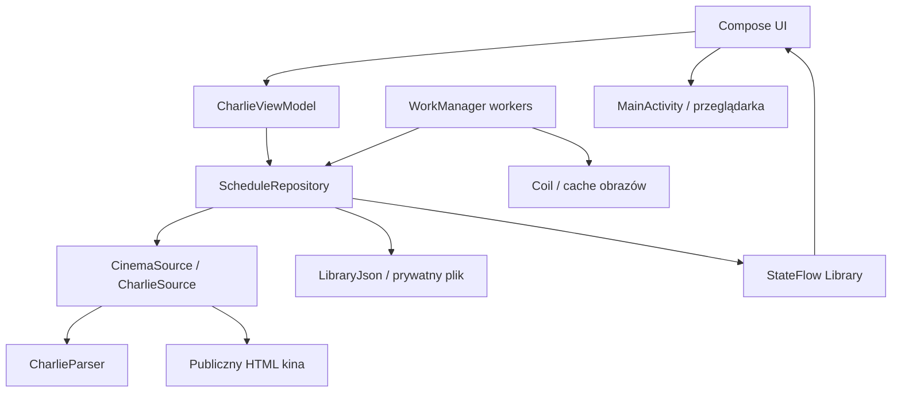

# Architektura aplikacji

Opis bieżącej implementacji MVP. Kontekst wyboru lokalnych snapshotów i zakupu w przeglądarce: [ADR 001](adr/001-offline-schedule.md). Znaczenie pojęć: [GLOSSARY](../GLOSSARY.md).

## Granice systemu

Aplikacja działa bez własnego serwera i konta użytkownika. Czyta publiczny repertuar kina, zapisuje lokalny katalog i przekazuje wybrany seans do strony sprzedażowej. Przeglądanie korzysta ze stanu lokalnego; płatność, miejsca i sesja zakupowa należą do przeglądarki.

Strzałki pokazują zależności i przepływ stanu; nie oznaczają, że Compose wykonuje żądania HTML. Obrazy mogą być ładowane przez Coil również podczas wyświetlania w UI.

## Mapa kodu

Wszystkie ścieżki Kotlin poniżej znajdują się w `app/src/main/java/pl/charlie/repertuar/`.

| Plik | Odpowiedzialność |
| --- | --- |
| [MainActivity.kt](../app/src/main/java/pl/charlie/repertuar/MainActivity.kt) | Zbiera stan z uwzględnieniem cyklu życia, wywołuje sprawdzenie po wznowieniu, otwiera zewnętrzne adresy |
| [CharlieViewModel.kt](../app/src/main/java/pl/charlie/repertuar/CharlieViewModel.kt) | Stan odświeżania, komunikaty błędów, łączność i bieżąca data kina; obsługa intencji UI |
| [CharlieApplication.kt](../app/src/main/java/pl/charlie/repertuar/CharlieApplication.kt) | Składanie zależności, wspólne repozytorium i ImageLoader, rejestracja pracy w tle; klasy SyncWorker i AssetsWorker |
| [ui/CharlieApp.kt](../app/src/main/java/pl/charlie/repertuar/ui/CharlieApp.kt) | Ekrany, lokalny stan nawigacji, wybór daty, wyszukiwanie, szczegóły i wybór seansu |
| [ui/CharlieTheme.kt](../app/src/main/java/pl/charlie/repertuar/ui/CharlieTheme.kt) | Wykonywalne definicje kolorów i typografii |
| [data/Models.kt](../app/src/main/java/pl/charlie/repertuar/data/Models.kt) | Film, Screening, ScheduleDay i Library |
| [data/ScheduleRepository.kt](../app/src/main/java/pl/charlie/repertuar/data/ScheduleRepository.kt) | Wspólny odczyt/zapis katalogu, odświeżanie, uzupełnianie opisów i zakładki |
| [data/CharlieSource.kt](../app/src/main/java/pl/charlie/repertuar/data/CharlieSource.kt) | Interfejs CinemaSource, HTTP i kodowanie znaków; SourceLinks waliduje adresy |
| [data/CharlieParser.kt](../app/src/main/java/pl/charlie/repertuar/data/CharlieParser.kt) | HTML i dane strukturalne źródła → modele; walidacja dnia i powiązania seansu |
| [data/LibraryJson.kt](../app/src/main/java/pl/charlie/repertuar/data/LibraryJson.kt) | Jawny, wersjonowany format zapisu bez refleksyjnej serializacji modeli |

## Odczyt i odświeżanie

Po wznowieniu `MainActivity` wywołuje `onResume()` ViewModelu. Repozytorium ładuje plik w `Dispatchers.IO` i publikuje `Library` przez `StateFlow`. Odczyt pliku jest wykonywany raz na instancję repozytorium. UI obserwuje dane, zamiast czekać na zakończenie pobierania.

ViewModel aktualizuje datę według `Europe/Warsaw`. Odświeżenie uruchamia, jeśli najnowszy zapis katalogu ma ponad sześć godzin albo brakuje dzisiejszego dnia. Ręczne odświeżenie używa tej samej ścieżki. Zmieniona data przekazana do Compose resetuje wybór dnia przez klucz `rememberSaveable`.

`refresh(start, count)` pobiera kolejne daty sekwencyjnie. Każdy poprawny dzień trafia na dysk i do stanu od razu; użytkownik nie czeka na cały zakres. Opisy już pobrane są zachowywane przy scalaniu nowych danych. Błąd dnia pozostawia poprzedni zapis. Jeśli błąd wystąpi przed pierwszym sukcesem, metoda kończy próbę całego zakresu; wtedy `failedDays` opisuje nieuzupełniony zakres, a nie liczbę wykonanych żądań HTTP.

`refreshLock` serializuje odświeżenia. `stateLock` chroni scalanie i zapis, także przy równoległym zapisywaniu filmu lub uzupełnianiu opisu. Są to blokady wewnątrz procesu; aplikacja nie konfiguruje osobnego procesu workerów.

## Zapis lokalny

| Zasób | Lokalizacja i reguła |
| --- | --- |
| Katalog, opisy, zapisane filmy | `filesDir/schedule/library.json`, format `version = 1` |
| Zapis roboczy | `library.tmp` → synchronizacja strumienia → atomowe zastąpienie pliku → publikacja nowego stanu |
| Obrazy | Prywatny `filesDir/posters`, cache Coil z limitem 80 MiB |

JSON przechowuje filmy wspólnie, dni odwołują się do ich identyfikatorów, a zakładki są zbiorem `savedIds`. Dekoder ponownie waliduje adresy zakupowe. Podczas udanego odświeżenia repozytorium usuwa dni spoza okna od wczoraj do `start + 13 dni`; zachowuje filmy obecne w dniach oraz zapisane przez użytkownika.

Brak pliku, nieczytelny JSON lub nieobsługiwana wersja daje obecnie pustą bibliotekę. Nie ma migracji ani pliku zapasowego. Przy zmianie formatu trzeba zaprojektować zgodny odczyt/migrację i zachowanie zakładek, zanim zmieni się wersję schematu. Samego numeru wersji aplikacji nie traktujemy jako migracji cache.

## Praca w tle i obrazy

`charlie-schedule` to unikalna praca okresowa WorkManager: sześć godzin, początkowe opóźnienie 20 minut, dostępna sieć i bateria powyżej niskiego poziomu. Polityka `KEEP` zachowuje istniejący harmonogram. Android ustala rzeczywisty moment wykonania.

`SyncWorker` ładuje katalog, odświeża do 14 dat i uzupełnia zasoby. Brak poprawnie odświeżonych dni lub częściowe niepowodzenie powoduje `retry`. Po udanym odświeżeniu z UI aplikacja kolejkuje osobne `charlie-assets`: opisy oraz pobranie obrazów, z wymaganą siecią.

Kolejność obrazu: pełny plakat → miniatura źródłowa → widoczny placeholder. UI i prefetch korzystają ze wspólnego ImageLoadera. Część adresów pełnych plakatów zwraca 404; miniatury mają ograniczoną rozdzielczość. `detailsFetched` oznacza pobrany niepusty opis; obecnie poprawnie pobrane opisy nie mają osobnego terminu wygaśnięcia.

## Kontrakty źródła i zakupu

Parser łączy wiersz HTML zawierający film, salę, godzinę i bilet z odpowiednim `ScreeningEvent`. Dane strukturalne dostarczają m.in. pełny plakat, reżysera i czas trwania. Nagłówek musi odpowiadać żądanej dacie; rozbieżność liczby odczytanych seansów względem danych strukturalnych odrzuca import. Dekodowanie HTTP/meta charset obsługuje starsze ISO-8859-2. HTML pozostaje w warstwie danych i nie jest renderowany jako interfejs aplikacji.

`SourceLinks` dopuszcza HTTPS, właściwy host, brak danych logowania w URL i domyślny port HTTPS. Źródła katalogu/obrazów to `charlie.pl` lub `www.charlie.pl`; zakup to `bilety.charlie.pl`. Dokładny adres seansu pochodzi z importu. ViewModel nie przetwarza płatności. Filmweb jest osobno konstruowanym, jawnie opisanym wyszukiwaniem po tytule.

### Zatwierdzone źródło dodatkowe

Użytkownik dopuścił publiczną listę `bilety.charlie.pl/MSI/mvc/pl` jako źródło uzupełniające. Jej [rozpoznanie i warunki integracji](sources/bilety-charlie.md) opisują dostępne pola, identyfikatory seansów oraz zaobserwowane konflikty. Obecny adapter jej nie importuje. Przed wdrożeniem alternatywnego odczytu trzeba zachować potwierdzone nazwy sal, tożsamość seansu, reguły adresów i ochronę cache przed niepełnymi danymi.

## Granice zmian i testowania

Sala jest istotną informacją wyboru seansu, zapisaną w istniejącym `Screening.room`. UI grupuje godziny według sal zarówno w repertuarze, jak i w zapisanych filmach; podgląd zapisanych obejmuje do trzech seansów na salę. Klucz seansu zawiera datę, godzinę, film i salę, więc identyczne godziny w różnych salach zachowują osobne akcje i adresy zakupowe. Szczegóły i arkusz zakupu powtarzają nazwę sali. Ta zmiana prezentacji nie zmienia formatu zapisu. Wymagania: [Widoczność sal](specs/rooms.md).

Zmianę struktury strony zaczynamy od nowego rzeczywistego fixture i regresji parsera. Zmiana trwałego stanu wymaga testu ponownego otwarcia oraz nieudanej synchronizacji przez publiczne API repozytorium. Zmiany stanów i nawigacji pokrywamy testami Compose. Polecenia i zakres kontroli przed wydaniem: [Development](DEVELOPMENT.md). Historia wyników MVP: [QA](QA.md).
